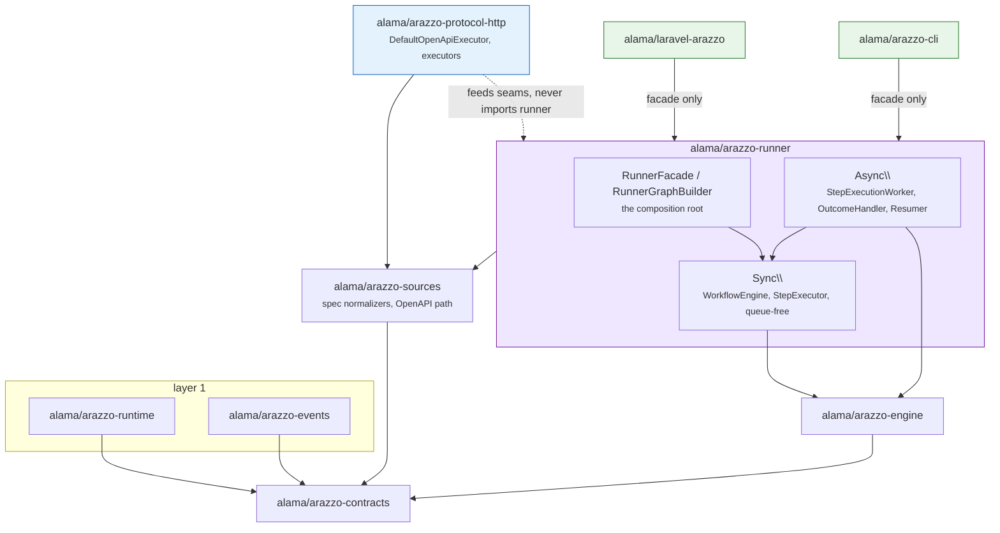

# 07 — Runner Package Map

## Purpose

Where execution lives and why: the package/layer model, the `Sync\`/`Async\` split inside `alama/arazzo-runner`, who owns which seam, and the arch tests that make each boundary un-crossable. This is the template a new protocol package (`protocol-soap`, `protocol-rpc`) should be read against — the composition surface is now stated once instead of being rediscovered from guard failures.

## The package model (source of truth)

| Layer | Package | Created in | Depends on |
|---|---|---|---|
| 1 | `alama/arazzo-runtime` | E1 | contracts |
| 1 | `alama/arazzo-events` | E2 | contracts |
| 3 | `alama/arazzo-engine` | E4 | contracts, evaluation, runtime |
| — | `alama/arazzo-sources` | pre-E | contracts, document, expression, cebe — hosts the spec normalizers (Option 2 re-merge, plan R2) |
| 5+6 | `alama/arazzo-runner` (`Sync\`/`Async\` + shared at root) | F2 | contracts, document, expression, evaluation, engine, runtime, events, sources, protocol-* |
| vertical | `alama/arazzo-protocol-http` | F1 | contracts, expression, evaluation, engine, sources (+ cebe/guzzle/PSR) — **never `runner` (DIP)** |
| vertical | `alama/arazzo-protocol-soap` | F4 | same as http minus cebe/guzzle; transport via contracts' `HttpClientInterface` |
| vertical | `alama/arazzo-protocol-rpc` | F5 | same as http minus illuminate; `.proto` parser stays here (spec D5 exception) |
| host | `alama/laravel-arazzo` | pre-F | runner **facade only** — never the runner's `Sync\`/`Async\` step-execution internals (F2.2 guard) |
| host | `alama/arazzo-cli` (in `packages/cli`) | pre-F | runner **facade only** — same F2.2 guard |

Dependency direction is strictly downward: every package may depend only on packages in rows above it. `runner` is the widest consumer; the vertical protocol packages sit **beside** it and feed it through seams; hosts consume only the facade.

## The `Sync\`/`Async\` split

F2.0 carved the live execution set out of the old flat `Execution\` namespace:

| Side | Package | Enforced by |
|---|---|---|
| `Sync\` | `WorkflowEngine`, `StepExecutor`, `SubWorkflowStepExecutor`, `ExecutionGraphFactory` | **queue-free** — must not reference `Async\` or `QueueDriverInterface` |
| `Async\` | `StepExecutionWorker`, `StepOutcomeHandler`, `CorrelationResumer`, `SubWorkflowInvoker`, `AsyncExecutionGraphAssembler`, `ExecuteStepJob`, `ResumeCorrelationJob` | **may compose `Sync\`** — the worker drives the same workflow engine |
| shared (root) | `RunnerFacade`, `RunnerGraphBuilder`, `AsyncExecutionGraph`, `OperationExecutorRegistry` | facade is the public face |

Rationale: sync execution is a plain transition loop (deterministic, synchronous, testable without queues); async execution is the queue-driven loop that re-enters the same engine between jobs. Expressing async *in terms of* sync and declaring sync queue-free keeps one transition semantics instead of two parallel implementations. The `Execution\` name still exists for the folded pipeline helpers (below) — it is not a third execution engine.

The facade (`RunnerGraphBuilder`) is the boundary hosts cross:

- `buildAsync(AsyncGraphSeams $seams)` — full graph (needs protocol value seams; used by `laravel`).
- `buildWorker(AsyncGraphSeams $seams)` — worker-only (no protocol seams; used by `cli` drain).

## Who owns which seam

| Seam (contracts port) | protocol-http | runner | laravel | cli |
|---|---|---|---|---|
| `OpenApiExecutorInterface` | `DefaultOpenApiExecutor` | consumed (nullable) | binds it | — |
| `OutputExtractorInterface` | `StepOutputExtractor` | consumed (nullable) | binds it | — |
| `ResponseValidatorInterface` | `ResponseSchemaValidator` | consumed (nullable) | binds it | — |
| `HttpClientInterface` | — | consumed | `Psr18HttpClient` | throws (no transport) |
| `LockManagerInterface` | — | consumed | `LaravelRedisLockManager` | in-process anon |
| `StateStoreInterface` / `QueueDriverInterface` / registries / ledgers | — | owned by the graph | Laravel DB/Redis impls | in-process fakes |

The tag vocabulary `ProtocolHttpRegistrar::tags()` (F2.2) is how a host registers protocol nodes **without naming the concretes** — the provider consumes the vocabulary, the host never imports `Protocol\HttpStepExecutor`/`AsyncApiStepExecutor`.

## Arch rules that enforce the boundaries

| Rule | Guard | Location |
|---|---|---|
| Sync is queue-free | `expect('…Runner\Sync')->not->toUse(['…Runner\Async', 'QueueDriverInterface'])` | `packages/runner/tests/ArchTest.php` |
| Async may compose Sync | `expect('…Runner\Async')->toUse('…Runner\Sync')` | runner `ArchTest.php` |
| Nothing below the facade depends on the facade | Sync/Async `not->toUse('RunnerFacade')` | runner `ArchTest.php` |
| Runner does not touch cebe directly | `expect('…Runner')->not->toUse('cebe\openapi')` | runner `ArchTest.php` |
| protocol-* must not depend on runner (**DIP**) | `expect('Alama\Arazzo\Protocol\Http')->not->toUse('Alama\Arazzo\Runner')` | `packages/protocol-http/tests/Architecture/ArchTest.php` |
| protocol-* stays framework-free | `not->toUse('Illuminate')` | protocol-http `Architecture/ArchTest.php` |
| Hosts may not name async execution internals | 7-symbol `not->toUse([…])` over `Alama\Arazzo\Laravel` / `Alama\Arazzo\Cli` | `packages/laravel/tests/Architecture/ArchTest.php`, `packages/cli/tests/ArchTest.php` |
| Folded pipeline helpers stay transport-agnostic | per-class `not->toUse(['Illuminate', 'cebe\openapi', 'GuzzleHttp'])` | runner `ArchTest.php` |

Each guard was proven to bite (temporary banned import → RED → byte-exact revert) when it was introduced — an arch test that cannot fail does not protect anything.

## Why there is no layer-2 package (read before re-proposing)

The first draft of this phase assumed a `request-pipeline` package (Plan E3) holding `RequestCompiler`, `ParameterSerializer`, `TypeCaster`, `SchemaValidator`, `IdempotencyKeyInjector`, `StepParameterMerger`, `ReusableParameterResolver`, `Data\InjectionResult`. That extraction was **reverted** in `c2b03fb`: these eight classes live as runner-internal helpers under `Alama\Arazzo\Runner\Execution`.

Why they stay: they are woven into the runner's own step-execution path (≈ one call site each), share `EvaluationContext` and `InjectionResult` with the runner core, and shipping them as a package would force a second seam surface (`protocol-*` → pipeline → runner) for zero reuse — no protocol package outside `runner` consumes them. The next reader who is tempted to split them out should treat `c2b03fb` as the prior decision and re-litigate only with concrete reuse evidence.

## Evidence

- [`docs/research/2026-09-26-runner-package-split-validation.md`](../research/2026-09-26-runner-package-split-validation.md) — measured dependency churn behind the `Sync\`/`Async\` split.
- [`docs/research/2026-09-08-arazzo-protocol-spec-prs-impact.md`](../research/2026-09-08-arazzo-protocol-spec-prs-impact.md) — the spec decisions (D4/D7/D9) driving vertical protocol packages and zero-core-edit.
- [`06 — Laravel Integration](./06-laravel-integration.md) — the host side of every seam above.