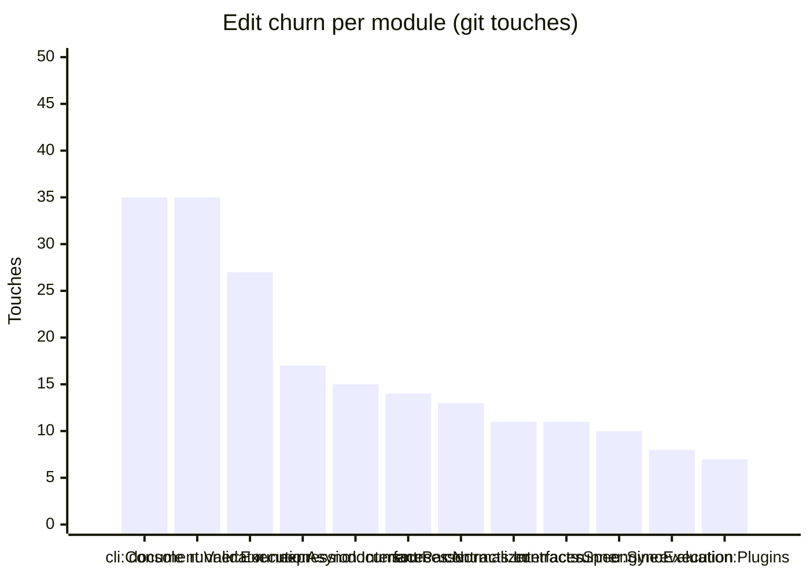

<!-- GENERATED by scripts/generate-docs.php — DO NOT EDIT.
     Refreshed automatically on every commit (see .githooks/pre-commit). -->

# Generated: Churn Hotspots

Where edit pressure lands. **Touches** = number of times a module's src files
appear in `git log` commits (full history, deterministic per HEAD). The
hotspot score normalizes churn by size: high touches-per-KLOC means a module
is edited far more often than its mass justifies — the classic "working in the
same corner every week" signal that static structure graphs cannot show.

Analyzed 330 total file-touches across 55 modules.

| Module | Touches | Share | LOC | Touches/KLOC |
|---|---:|---:|---:|---:|
| `cli:Console` | 35 | 11% | 943 | 37.1 |
| `document:Validator` | 35 | 11% | 5,199 | 6.7 |
| `runner:Execution` | 27 | 8% | 383 | 70.5 |
| `runner:Async` | 17 | 5% | 1,346 | 12.6 |
| `expression:Interfaces` | 15 | 5% | 211 | 71.1 |
| `document:Parser` | 14 | 4% | 1,453 | 9.6 |
| `sources:Normalizer` | 13 | 4% | 1,282 | 10.1 |
| `contracts:Interfaces` | 11 | 3% | 367 | 30 |
| `contracts:Spec` | 11 | 3% | 1,207 | 9.1 |
| `runner:Sync` | 10 | 3% | 1,046 | 9.6 |
| `engine:Execution` | 8 | 2% | 1,031 | 7.8 |
| `evaluation:Plugins` | 7 | 2% | 120 | 58.3 |
| `protocol-http:Protocol` | 7 | 2% | 329 | 21.3 |
| `evaluation:Condition` | 6 | 2% | 1,023 | 5.9 |
| `evaluation:Registries` | 6 | 2% | 121 | 49.6 |
| `expression:Data` | 6 | 2% | 186 | 32.3 |
| `expression:Ast` | 5 | 2% | 355 | 14.1 |
| `expression:Xpath` | 5 | 2% | 173 | 28.9 |
| `protocol-http:Registrar` | 5 | 2% | 141 | 35.5 |
| `protocol-soap:Execution` | 5 | 2% | 597 | 8.4 |
| `runner:Events` | 5 | 2% | 328 | 15.2 |
| `sources:Resolver` | 5 | 2% | 512 | 9.8 |
| `cli:Generator` | 4 | 1% | 141 | 28.4 |
| `cli:Renderer` | 4 | 1% | 255 | 15.7 |
| `contracts:Dependency` | 4 | 1% | 336 | 11.9 |
| `evaluation:Data` | 4 | 1% | 86 | 46.5 |
| `expression:Enum` | 4 | 1% | 47 | 85.1 |
| `protocol-http:Execution` | 4 | 1% | 536 | 7.5 |
| `contracts:State` | 3 | 1% | 910 | 3.3 |
| `contracts:Support` | 3 | 1% | 185 | 16.2 |
| `evaluation:Interfaces` | 3 | 1% | 44 | 68.2 |
| `expression:Internal` | 3 | 1% | 433 | 6.9 |
| `protocol-rpc:Execution` | 3 | 1% | 313 | 9.6 |
| `sources:Validator` | 3 | 1% | 325 | 9.2 |
| `contracts:Exceptions` | 2 | 1% | 31 | 64.5 |
| `engine:Data` | 2 | 1% | 74 | 27 |
| `engine:Enum` | 2 | 1% | 17 | 117.6 |
| `evaluation:Enum` | 2 | 1% | 123 | 16.3 |
| `expression:Exceptions` | 2 | 1% | 64 | 31.3 |
| `expression:Plugins` | 2 | 1% | 128 | 15.6 |
| `expression:Registries` | 2 | 1% | 73 | 27.4 |
| `protocol-rpc:Normalizer` | 2 | 1% | 661 | 3 |
| `protocol-rpc:Registrar` | 2 | 1% | 93 | 21.5 |
| `protocol-soap:Registrar` | 2 | 1% | 97 | 20.6 |
| `engine:Exceptions` | 1 | 0% | 42 | 23.8 |
| `engine:Runtime` | 1 | 0% | 1,602 | 0.6 |
| `evaluation:Events` | 1 | 0% | 27 | 37 |
| `expression:Support` | 1 | 0% | 59 | 16.9 |
| `protocol-rpc:Protocol` | 1 | 0% | 514 | 1.9 |
| `protocol-rpc:Transfer` | 1 | 0% | 219 | 4.6 |
| `protocol-soap:Resolver` | 1 | 0% | 136 | 7.4 |
| `protocol-soap:Transfer` | 1 | 0% | 203 | 4.9 |
| `protocol-soap:Validation` | 1 | 0% | 139 | 7.2 |
| `runner:Interfaces` | 1 | 0% | 25 | 40 |
| `expression:JsonPath` | 0 | 0% | 1,315 | 0 |

**Hotspots** (highest touches-per-KLOC with meaningful size/churn): `expression:Interfaces` (71.1), `runner:Execution` (70.5), `evaluation:Plugins` (58.3)
