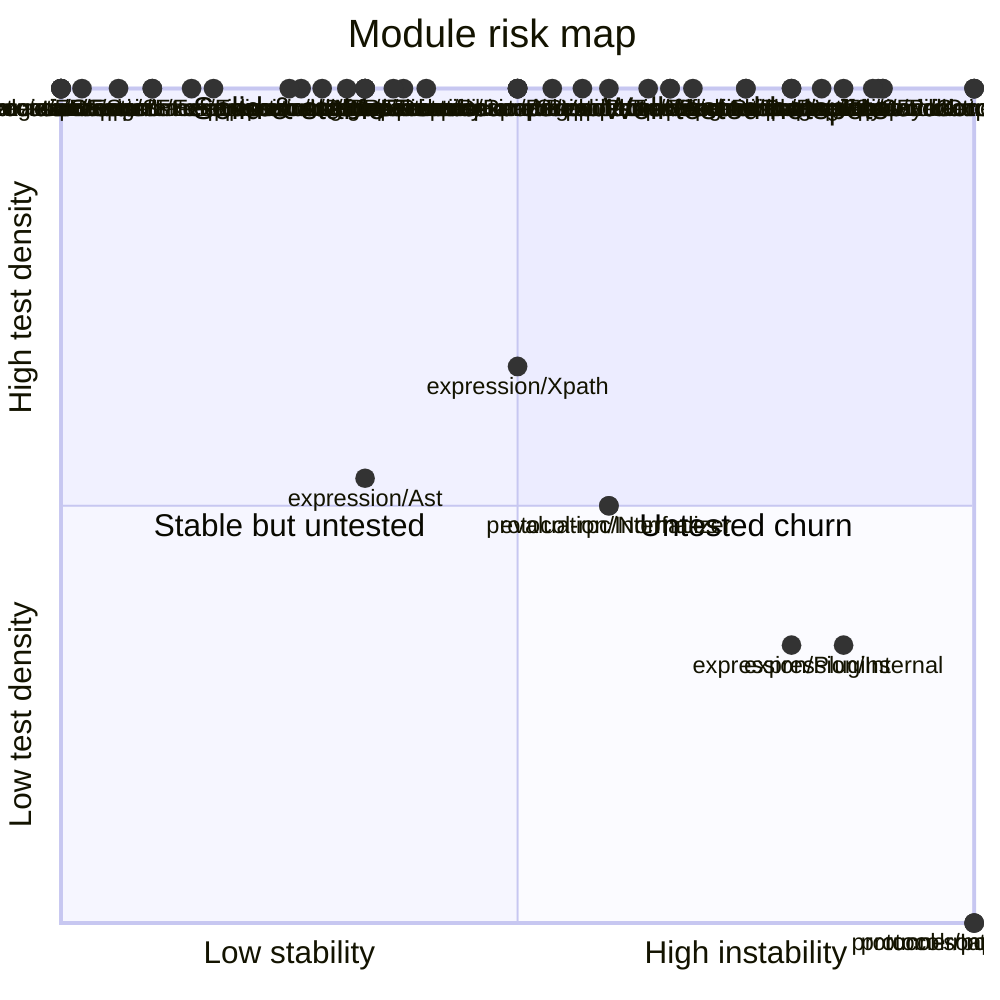

<!-- GENERATED by scripts/generate-docs.php — DO NOT EDIT.
     Refreshed automatically on every commit (see .githooks/pre-commit). -->

# Generated: Coverage / Risk Quadrant

Each module plotted by **instability** (x, from the coupling graph) vs **test
density** (y: test files referencing the module ÷ src files in it).

- *Untested churn* (bottom-right) — changing constantly with no safety net: refactor first.
- *Well-tested hotspots* (top-right) — churn is paid for; keep tests green.
- Test density is file-level and name-based (a test file counts once per
  module whose class names it mentions); it is a proxy, not line coverage.

| Module | Instability | Test files | Src files | Density |
|---|---:|---:|---:|---:|
| `cli/Console` | 1.00 | 12 | 12 | 100% |
| `cli/Generator` | 1.00 | 2 | 2 | 100% |
| `cli/Renderer` | 0.50 | 7 | 1 | 100% |
| `contracts/Dependency` | 0.33 | 6 | 3 | 100% |
| `contracts/Exceptions` | 0.00 | 5 | 1 | 100% |
| `contracts/Interfaces` | 0.10 | 43 | 19 | 100% |
| `contracts/Spec` | 0.02 | 278 | 49 | 100% |
| `contracts/State` | 0.06 | 83 | 3 | 100% |
| `contracts/Support` | 0.00 | 13 | 5 | 100% |
| `document/Parser` | 0.29 | 54 | 12 | 100% |
| `document/Validator` | 0.54 | 100 | 81 | 100% |
| `engine/Data` | 0.75 | 2 | 2 | 100% |
| `engine/Enum` | 0.00 | 1 | 1 | 100% |
| `engine/Exceptions` | 0.14 | 5 | 1 | 100% |
| `engine/Execution` | 0.36 | 12 | 8 | 100% |
| `engine/Runtime` | 0.38 | 31 | 19 | 100% |
| `evaluation/Condition` | 0.89 | 67 | 17 | 100% |
| `evaluation/Data` | 0.40 | 16 | 2 | 100% |
| `evaluation/Enum` | 0.00 | 6 | 5 | 100% |
| `evaluation/Events` | 0.33 | 1 | 1 | 100% |
| `evaluation/Interfaces` | 0.60 | 1 | 2 | 50% |
| `evaluation/Plugins` | 0.75 | 3 | 2 | 100% |
| `evaluation/Registries` | 0.80 | 2 | 2 | 100% |
| `expression/Ast` | 0.33 | 8 | 15 | 53% |
| `expression/Data` | 0.25 | 28 | 6 | 100% |
| `expression/Enum` | 0.00 | 8 | 2 | 100% |
| `expression/Exceptions` | 0.10 | 17 | 2 | 100% |
| `expression/Interfaces` | 0.26 | 24 | 5 | 100% |
| `expression/Internal` | 0.86 | 1 | 3 | 33% |
| `expression/JsonPath` | 0.67 | 55 | 7 | 100% |
| `expression/Plugins` | 0.80 | 1 | 3 | 33% |
| `expression/Registries` | 0.50 | 1 | 1 | 100% |
| `expression/Support` | 0.50 | 4 | 1 | 100% |
| `expression/Xpath` | 0.50 | 2 | 3 | 67% |
| `protocol-http/Execution` | 0.64 | 30 | 4 | 100% |
| `protocol-http/Protocol` | 0.90 | 10 | 2 | 100% |
| `protocol-http/Registrar` | 1.00 | 1 | 1 | 100% |
| `protocol-rpc/Execution` | 0.90 | 3 | 3 | 100% |
| `protocol-rpc/Normalizer` | 0.60 | 3 | 6 | 50% |
| `protocol-rpc/Protocol` | 0.57 | 6 | 4 | 100% |
| `protocol-rpc/Registrar` | 1.00 | 0 | 1 | 0% |
| `protocol-rpc/Transfer` | 0.60 | 3 | 2 | 100% |
| `protocol-soap/Execution` | 0.83 | 5 | 5 | 100% |
| `protocol-soap/Registrar` | 1.00 | 0 | 1 | 0% |
| `protocol-soap/Resolver` | 0.50 | 1 | 1 | 100% |
| `protocol-soap/Transfer` | 0.33 | 5 | 2 | 100% |
| `protocol-soap/Validation` | 0.80 | 1 | 1 | 100% |
| `runner/Async` | 0.90 | 15 | 7 | 100% |
| `runner/Events` | 0.17 | 32 | 11 | 100% |
| `runner/Execution` | 0.69 | 35 | 16 | 100% |
| `runner/Interfaces` | 1.00 | 0 | 1 | 0% |
| `runner/Sync` | 0.86 | 37 | 6 | 100% |
| `sources/Normalizer` | 0.31 | 21 | 11 | 100% |
| `sources/Resolver` | 0.33 | 31 | 13 | 100% |
| `sources/Validator` | 0.67 | 3 | 1 | 100% |

**Refactor-now list** (untested churn): `protocol-rpc/Registrar`, `protocol-soap/Registrar`, `runner/Interfaces`
