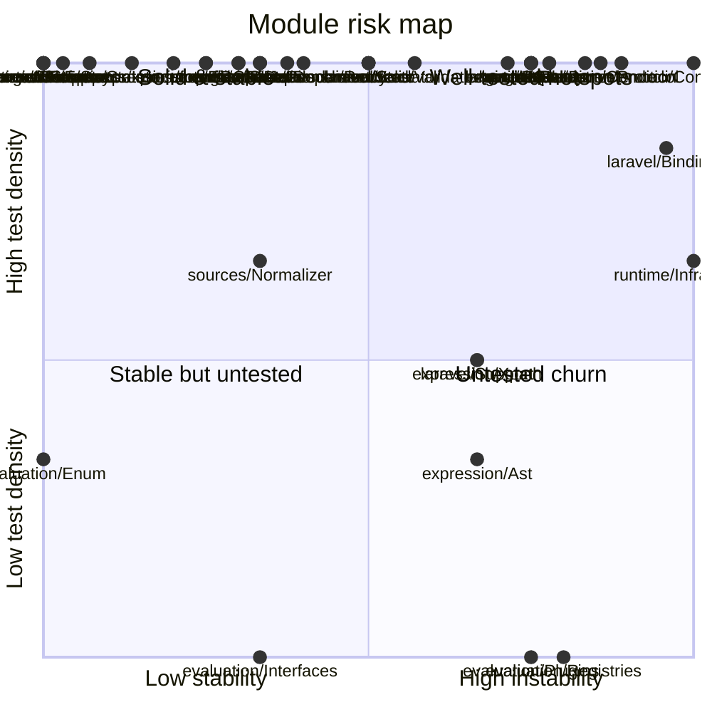

<!-- GENERATED by scripts/generate-docs.php — DO NOT EDIT.
     Refreshed automatically on every commit (see .githooks/pre-commit). -->

# Generated: Coverage / Risk Quadrant

Each module plotted by **instability** (x, from the coupling graph) vs **test
density** (y: test files referencing the module ÷ src files in it).

- *Untested churn* (bottom-right) — changing constantly with no safety net: refactor first.
- *Well-tested hotspots* (top-right) — churn is paid for; keep tests green.
- Test density is file-level and name-based (a test file counts once per
  module whose class names it mentions); it is a proxy, not line coverage.

| Module | Instability | Test files | Src files | Density |
|---|---:|---:|---:|---:|
| `cli/Console` | 1.00 | 11 | 11 | 100% |
| `cli/Generator` | 0.33 | 5 | 2 | 100% |
| `cli/Renderer` | 0.50 | 3 | 1 | 100% |
| `contracts/Dependency` | 0.40 | 5 | 3 | 100% |
| `contracts/Exceptions` | 0.00 | 3 | 1 | 100% |
| `contracts/Interfaces` | 0.14 | 33 | 19 | 100% |
| `contracts/Spec` | 0.03 | 195 | 49 | 100% |
| `contracts/State` | 0.07 | 51 | 2 | 100% |
| `contracts/Support` | 0.00 | 10 | 5 | 100% |
| `document/Parser` | 0.25 | 35 | 11 | 100% |
| `document/Validator` | 0.50 | 74 | 68 | 100% |
| `engine/Data` | 0.75 | 3 | 2 | 100% |
| `engine/Enum` | 0.00 | 1 | 1 | 100% |
| `engine/Exceptions` | 0.33 | 3 | 1 | 100% |
| `engine/Execution` | 0.75 | 9 | 7 | 100% |
| `evaluation/Condition` | 0.86 | 42 | 10 | 100% |
| `evaluation/Enum` | 0.00 | 1 | 3 | 33% |
| `evaluation/Interfaces` | 0.33 | 0 | 2 | 0% |
| `evaluation/Plugins` | 0.75 | 0 | 2 | 0% |
| `evaluation/Registries` | 0.80 | 0 | 2 | 0% |
| `events/Interfaces` | 0.00 | 19 | 1 | 100% |
| `events/Listener` | 0.75 | 3 | 1 | 100% |
| `expression/Ast` | 0.67 | 5 | 15 | 33% |
| `expression/Data` | 0.30 | 12 | 4 | 100% |
| `expression/Enum` | 0.00 | 4 | 2 | 100% |
| `expression/Exceptions` | 0.25 | 6 | 2 | 100% |
| `expression/Interfaces` | 0.20 | 13 | 2 | 100% |
| `expression/Xpath` | 0.67 | 1 | 2 | 50% |
| `laravel/Bindings` | 0.96 | 6 | 7 | 86% |
| `laravel/Events` | 0.00 | 1 | 1 | 100% |
| `laravel/Http` | 0.71 | 4 | 3 | 100% |
| `laravel/Lock` | 0.50 | 3 | 1 | 100% |
| `laravel/Persistence` | 0.83 | 6 | 4 | 100% |
| `laravel/Queue` | 0.75 | 6 | 3 | 100% |
| `laravel/State` | 0.50 | 3 | 1 | 100% |
| `laravel/Support` | 0.67 | 1 | 2 | 50% |
| `runner/Execution` | 0.78 | 41 | 26 | 100% |
| `runner/Jobs` | 0.33 | 5 | 2 | 100% |
| `runner/Protocol` | 0.89 | 2 | 1 | 100% |
| `runtime/Infrastructure` | 1.00 | 2 | 3 | 67% |
| `runtime/Policy` | 0.75 | 2 | 2 | 100% |
| `runtime/State` | 0.30 | 25 | 12 | 100% |
| `runtime/Telemetry` | 0.00 | 2 | 2 | 100% |
| `sources/Normalizer` | 0.33 | 2 | 3 | 67% |
| `sources/Resolver` | 0.38 | 19 | 13 | 100% |
| `sources/Validator` | 0.57 | 3 | 1 | 100% |

**Refactor-now list** (untested churn): `evaluation/Registries`, `evaluation/Plugins`
