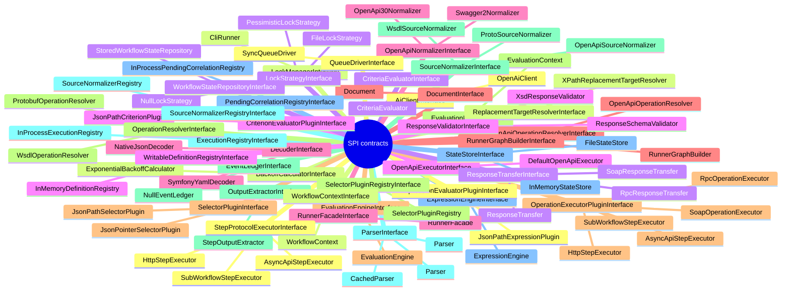

<!-- GENERATED by scripts/generate-docs.php — DO NOT EDIT.
     Refreshed automatically on every commit (see .githooks/pre-commit). -->

# Generated: Extension Points (SPI)

Every contract interface that other code implements, with its live
implementation set — the package's openness map. Contracts under a `Contracts`
directory are deliberate SPI; others appear when the codebase itself treats an
interface polymorphically. Interfaces nobody implements are listed separately:
either dead seams or seams waiting for their first adapter.

| Contract | SPI dir | Implementations |
|---|---|---|
| `AiClientInterface` | no | `OpenAiClient` <small>core</small> |
| `BackoffCalculatorInterface` | no | `ExponentialBackoffCalculator` <small>core</small> |
| `CriteriaEvaluatorInterface` | no | `CriteriaEvaluator` <small>core</small> |
| `CriterionEvaluatorPluginInterface` | no | `JsonPathCriterionPlugin` <small>core</small> |
| `DecoderInterface` | no | `NativeJsonDecoder` <small>core</small>, `SymfonyYamlDecoder` <small>core</small> |
| `DocumentInterface` | no | `Document` <small>core</small> |
| `EvaluationEngineInterface` | no | `EvaluationEngine` <small>core</small> |
| `EvaluationInputInterface` | no | `EvaluationContext` <small>core</small> |
| `EventLedgerInterface` | no | `NullEventLedger` <small>core</small> |
| `ExecutionRegistryInterface` | no | `InProcessExecutionRegistry` <small>core</small> |
| `ExpressionEngineInterface` | no | `ExpressionEngine` <small>core</small> |
| `ExpressionEvaluatorPluginInterface` | no | `JsonPathExpressionPlugin` <small>core</small> |
| `LockManagerInterface` | no | `CliRunner` <small>core</small> |
| `LockStrategyInterface` | no | `FileLockStrategy` <small>core</small>, `NullLockStrategy` <small>core</small>, `PessimisticLockStrategy` <small>core</small> |
| `OpenApiExecutorInterface` | no | `DefaultOpenApiExecutor` <small>core</small> |
| `OpenApiNormalizerInterface` | no | `OpenApi30Normalizer` <small>core</small>, `Swagger2Normalizer` <small>core</small> |
| `OpenApiOperationResolverInterface` | no | `OpenApiOperationResolver` <small>core</small> |
| `OperationExecutorPluginInterface` | no | `AsyncApiStepExecutor` <small>core</small>, `HttpStepExecutor` <small>core</small>, `RpcOperationExecutor` <small>core</small>, `SoapOperationExecutor` <small>core</small>, `SubWorkflowStepExecutor` <small>core</small> |
| `OperationResolverInterface` | no | `ProtobufOperationResolver` <small>core</small>, `WsdlOperationResolver` <small>core</small> |
| `OutputExtractorInterface` | no | `StepOutputExtractor` <small>core</small> |
| `ParserInterface` | no | `Parser` <small>core</small>, `CachedParser` <small>core</small>, `Parser` <small>core</small> |
| `PendingCorrelationRegistryInterface` | no | `InProcessPendingCorrelationRegistry` <small>core</small> |
| `QueueDriverInterface` | no | `SyncQueueDriver` <small>core</small> |
| `ReplacementTargetResolverInterface` | no | `XPathReplacementTargetResolver` <small>core</small> |
| `ResponseTransferInterface` | no | `ResponseTransfer` <small>core</small>, `RpcResponseTransfer` <small>core</small>, `SoapResponseTransfer` <small>core</small> |
| `ResponseValidatorInterface` | no | `ResponseSchemaValidator` <small>core</small>, `XsdResponseValidator` <small>core</small> |
| `RunnerFacadeInterface` | no | `RunnerFacade` <small>core</small> |
| `RunnerGraphBuilderInterface` | no | `RunnerGraphBuilder` <small>core</small> |
| `SelectorPluginInterface` | no | `JsonPathSelectorPlugin` <small>core</small>, `JsonPointerSelectorPlugin` <small>core</small> |
| `SelectorPluginRegistryInterface` | no | `SelectorPluginRegistry` <small>core</small> |
| `SourceNormalizerInterface` | no | `OpenApiSourceNormalizer` <small>core</small>, `WsdlSourceNormalizer` <small>core</small>, `ProtoSourceNormalizer` <small>core</small> |
| `SourceNormalizerRegistryInterface` | no | `SourceNormalizerRegistry` <small>core</small> |
| `StateStoreInterface` | no | `FileStateStore` <small>core</small>, `InMemoryStateStore` <small>core</small> |
| `StepProtocolExecutorInterface` | no | `AsyncApiStepExecutor` <small>core</small>, `HttpStepExecutor` <small>core</small>, `SubWorkflowStepExecutor` <small>core</small> |
| `WorkflowContextInterface` | no | `WorkflowContext` <small>core</small> |
| `WorkflowStateRepositoryInterface` | no | `StoredWorkflowStateRepository` <small>core</small> |
| `WritableDefinitionRegistryInterface` | no | `InMemoryDefinitionRegistry` <small>core</small> |

## Unimplemented contracts

Declared but nothing in src implements them — candidates for removal or for a first adapter:

- `DefinitionRegistryInterface` <small>Runtime/State/Interfaces</small>
- `HttpClientInterface` <small>Interfaces</small>
- `PluginInterface` <small>Interfaces</small>
- `ProtocolExecutorRegistryInterface` <small>Interfaces</small>
- `WorkflowEngineInterface` <small></small>
