<!-- GENERATED by scripts/generate-docs.php — DO NOT EDIT.
     Refreshed automatically on every commit (see .githooks/pre-commit). -->

# Generated: Pipeline Flow

Execution topology of the execution path: every concrete service under
`Runner/` (plus Laravel queue jobs) with the edges
introduced by constructor injection or direct instantiation. Entry points
(nothing injects them) are green. Isolated value objects, enums and
exceptions are omitted. Regenerated before every commit.

```mermaid
flowchart TD
    subgraph G_Async["Async"]
        Alama_Arazzo_Runner_Async_AsyncExecutionGraphAssembler["AsyncExecutionGraphAssembler"]:::entry
        Alama_Arazzo_Runner_Async_CorrelationResumer["CorrelationResumer"]:::service
        Alama_Arazzo_Runner_Async_ExecuteStepJob["ExecuteStepJob"]:::service
        Alama_Arazzo_Runner_Async_ResumeCorrelationJob["ResumeCorrelationJob"]:::service
        Alama_Arazzo_Runner_Async_StepExecutionWorker["StepExecutionWorker"]:::service
        Alama_Arazzo_Runner_Async_StepOutcomeHandler["StepOutcomeHandler"]:::service
        Alama_Arazzo_Runner_Async_SubWorkflowInvoker["SubWorkflowInvoker"]:::service
    end
    subgraph G_Execution["Execution"]
        Alama_Arazzo_Runner_Execution_OperationRuntime["OperationRuntime"]:::service
    end
    subgraph G_Execution_Data["Execution/Data"]
        Alama_Arazzo_Runner_Execution_Data_ExecutionResult["ExecutionResult"]:::service
        Alama_Arazzo_Runner_Execution_Data_RunControlFlow["RunControlFlow"]:::service
        Alama_Arazzo_Runner_Execution_Data_RunPersistence["RunPersistence"]:::service
        Alama_Arazzo_Runner_Execution_Data_StepResult["StepResult"]:::service
        Alama_Arazzo_Runner_Execution_Data_SubWorkflowResult["SubWorkflowResult"]:::service
    end
    subgraph G_Queue_Jobs["Queue/Jobs"]
        Alama_Arazzo_Laravel_Queue_Jobs_RunExecuteStepJob["RunExecuteStepJob"]:::entry
        Alama_Arazzo_Laravel_Queue_Jobs_RunResumeCorrelationJob["RunResumeCorrelationJob"]:::entry
    end
    subgraph G_Sync["Sync"]
        Alama_Arazzo_Runner_Sync_ExecutionGraphFactory["ExecutionGraphFactory"]:::entry
        Alama_Arazzo_Runner_Sync_StepExecutor["StepExecutor"]:::service
        Alama_Arazzo_Runner_Sync_SubWorkflowStepExecutor["SubWorkflowStepExecutor"]:::service
        Alama_Arazzo_Runner_Sync_WorkflowEngine["WorkflowEngine"]:::service
        Alama_Arazzo_Runner_Sync_WorkflowExecutor["WorkflowExecutor"]:::service
    end
    Alama_Arazzo_Laravel_Queue_Jobs_RunExecuteStepJob --> Alama_Arazzo_Runner_Async_ExecuteStepJob
    Alama_Arazzo_Laravel_Queue_Jobs_RunResumeCorrelationJob --> Alama_Arazzo_Runner_Async_ResumeCorrelationJob
    Alama_Arazzo_Runner_Async_AsyncExecutionGraphAssembler --> Alama_Arazzo_Runner_Async_CorrelationResumer
    Alama_Arazzo_Runner_Async_AsyncExecutionGraphAssembler --> Alama_Arazzo_Runner_Async_StepExecutionWorker
    Alama_Arazzo_Runner_Async_AsyncExecutionGraphAssembler --> Alama_Arazzo_Runner_Async_StepOutcomeHandler
    Alama_Arazzo_Runner_Async_AsyncExecutionGraphAssembler --> Alama_Arazzo_Runner_Async_SubWorkflowInvoker
    Alama_Arazzo_Runner_Async_AsyncExecutionGraphAssembler --> Alama_Arazzo_Runner_Execution_Data_RunControlFlow
    Alama_Arazzo_Runner_Async_AsyncExecutionGraphAssembler --> Alama_Arazzo_Runner_Execution_Data_RunPersistence
    Alama_Arazzo_Runner_Async_AsyncExecutionGraphAssembler --> Alama_Arazzo_Runner_Execution_OperationRuntime
    Alama_Arazzo_Runner_Async_AsyncExecutionGraphAssembler --> Alama_Arazzo_Runner_Sync_StepExecutor
    Alama_Arazzo_Runner_Async_AsyncExecutionGraphAssembler --> Alama_Arazzo_Runner_Sync_SubWorkflowStepExecutor
    Alama_Arazzo_Runner_Async_AsyncExecutionGraphAssembler --> Alama_Arazzo_Runner_Sync_WorkflowEngine
    Alama_Arazzo_Runner_Async_AsyncExecutionGraphAssembler --> Alama_Arazzo_Runner_Sync_WorkflowExecutor
    Alama_Arazzo_Runner_Async_CorrelationResumer --> Alama_Arazzo_Runner_Async_StepOutcomeHandler
    Alama_Arazzo_Runner_Async_StepExecutionWorker --> Alama_Arazzo_Runner_Async_ExecuteStepJob
    Alama_Arazzo_Runner_Async_StepExecutionWorker --> Alama_Arazzo_Runner_Sync_WorkflowEngine
    Alama_Arazzo_Runner_Async_StepOutcomeHandler --> Alama_Arazzo_Runner_Async_ExecuteStepJob
    Alama_Arazzo_Runner_Async_StepOutcomeHandler --> Alama_Arazzo_Runner_Async_SubWorkflowInvoker
    Alama_Arazzo_Runner_Async_StepOutcomeHandler --> Alama_Arazzo_Runner_Sync_WorkflowEngine
    Alama_Arazzo_Runner_Async_SubWorkflowInvoker --> Alama_Arazzo_Runner_Execution_Data_SubWorkflowResult
    Alama_Arazzo_Runner_Async_SubWorkflowInvoker --> Alama_Arazzo_Runner_Sync_WorkflowExecutor
    Alama_Arazzo_Runner_Execution_Data_RunControlFlow --> Alama_Arazzo_Runner_Sync_WorkflowEngine
    Alama_Arazzo_Runner_Sync_ExecutionGraphFactory --> Alama_Arazzo_Runner_Execution_OperationRuntime
    Alama_Arazzo_Runner_Sync_ExecutionGraphFactory --> Alama_Arazzo_Runner_Sync_StepExecutor
    Alama_Arazzo_Runner_Sync_ExecutionGraphFactory --> Alama_Arazzo_Runner_Sync_WorkflowEngine
    Alama_Arazzo_Runner_Sync_ExecutionGraphFactory --> Alama_Arazzo_Runner_Sync_WorkflowExecutor
    Alama_Arazzo_Runner_Sync_SubWorkflowStepExecutor --> Alama_Arazzo_Runner_Sync_WorkflowExecutor
    Alama_Arazzo_Runner_Sync_WorkflowExecutor --> Alama_Arazzo_Runner_Execution_Data_ExecutionResult
    Alama_Arazzo_Runner_Sync_WorkflowExecutor --> Alama_Arazzo_Runner_Execution_Data_StepResult
    Alama_Arazzo_Runner_Sync_WorkflowExecutor --> Alama_Arazzo_Runner_Sync_StepExecutor
    Alama_Arazzo_Runner_Sync_WorkflowExecutor --> Alama_Arazzo_Runner_Sync_WorkflowEngine
    classDef entry fill:#e6f4ea,stroke:#34a853,color:#1a1a1a;
    classDef service fill:#e8f0fe,stroke:#4285f4,color:#1a1a1a;
    classDef laravelNode fill:#fef7e0,stroke:#f9ab00,color:#1a1a1a;
```

| Service | Package | Depends on | Used by | Dispatches |
|---|---|---|---|---|
| **RunExecuteStepJob** | laravel | `ExecuteStepJob` | — | — |
| **RunResumeCorrelationJob** | laravel | `ResumeCorrelationJob` | — | — |
| **AsyncExecutionGraphAssembler** | runner | `CorrelationResumer`, `StepExecutionWorker`, `StepOutcomeHandler`, `SubWorkflowInvoker`, `RunControlFlow`, `RunPersistence`, `OperationRuntime`, `StepExecutor`, `SubWorkflowStepExecutor`, `WorkflowEngine`, `WorkflowExecutor` | — | — |
| **CorrelationResumer** | runner | `StepOutcomeHandler` | `AsyncExecutionGraphAssembler` | — |
| **ExecuteStepJob** | runner | — | `RunExecuteStepJob`, `StepExecutionWorker`, `StepOutcomeHandler` | — |
| **ResumeCorrelationJob** | runner | — | `RunResumeCorrelationJob` | — |
| **StepExecutionWorker** | runner | `ExecuteStepJob`, `WorkflowEngine` | `AsyncExecutionGraphAssembler` | — |
| **StepOutcomeHandler** | runner | `ExecuteStepJob`, `SubWorkflowInvoker`, `WorkflowEngine` | `AsyncExecutionGraphAssembler`, `CorrelationResumer` | — |
| **SubWorkflowInvoker** | runner | `SubWorkflowResult`, `WorkflowExecutor` | `AsyncExecutionGraphAssembler`, `StepOutcomeHandler` | — |
| **ExecutionResult** | runner | — | `WorkflowExecutor` | — |
| **RunControlFlow** | runner | `WorkflowEngine` | `AsyncExecutionGraphAssembler` | — |
| **RunPersistence** | runner | — | `AsyncExecutionGraphAssembler` | — |
| **StepResult** | runner | — | `WorkflowExecutor` | — |
| **SubWorkflowResult** | runner | — | `SubWorkflowInvoker` | — |
| **OperationRuntime** | runner | — | `AsyncExecutionGraphAssembler`, `ExecutionGraphFactory` | — |
| **ExecutionGraphFactory** | runner | `OperationRuntime`, `StepExecutor`, `WorkflowEngine`, `WorkflowExecutor` | — | — |
| **StepExecutor** | runner | — | `AsyncExecutionGraphAssembler`, `ExecutionGraphFactory`, `WorkflowExecutor` | — |
| **SubWorkflowStepExecutor** | runner | `WorkflowExecutor` | `AsyncExecutionGraphAssembler` | — |
| **WorkflowEngine** | runner | — | `AsyncExecutionGraphAssembler`, `StepExecutionWorker`, `StepOutcomeHandler`, `RunControlFlow`, `ExecutionGraphFactory`, `WorkflowExecutor` | — |
| **WorkflowExecutor** | runner | `ExecutionResult`, `StepResult`, `StepExecutor`, `WorkflowEngine` | `AsyncExecutionGraphAssembler`, `SubWorkflowInvoker`, `ExecutionGraphFactory`, `SubWorkflowStepExecutor` | — |
