<!-- GENERATED by scripts/generate-docs.php — DO NOT EDIT.
     Refreshed automatically on every commit (see .githooks/pre-commit). -->

# Generated: Test Suite Composition

Shape of the reliability evidence, counted by test file (`*Test.php`) per
suite directory in `packages/*/tests`. A healthy package usually shows a wide
unit base, a deliberate feature layer, and a conformance slice proving spec
compliance — not an inverted pyramid of end-to-end tests.

## Contracts package

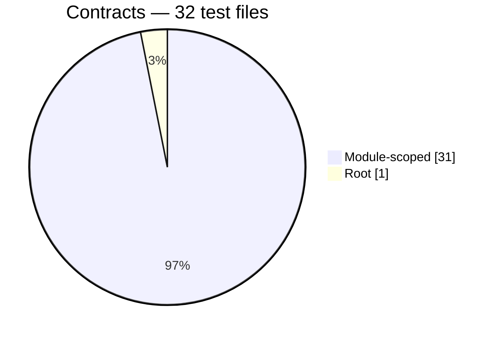

| Suite | Files | Share |
|---|---:|---:|
| Module-scoped | 31 | 97% |
| Root | 1 | 3% |

## Expression package

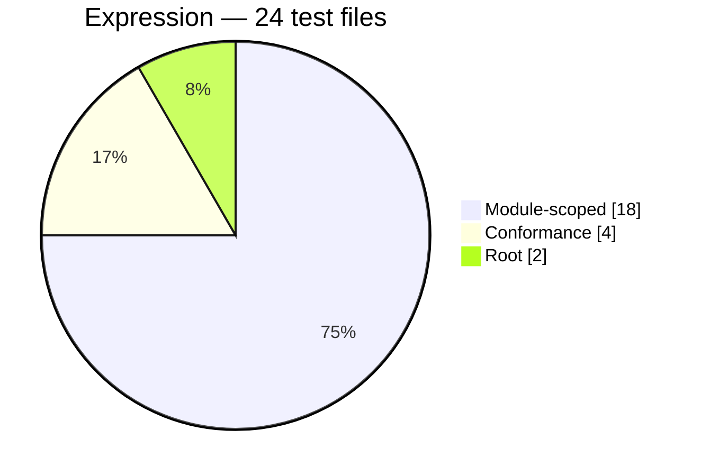

| Suite | Files | Share |
|---|---:|---:|
| Module-scoped | 18 | 75% |
| Conformance | 4 | 17% |
| Root | 2 | 8% |

## Evaluation package

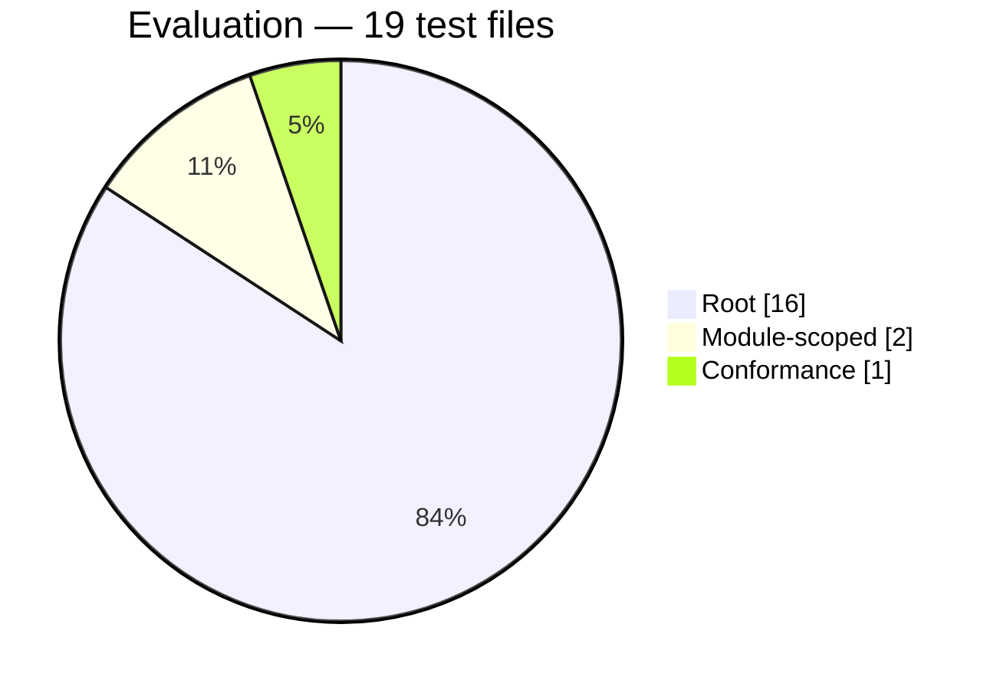

| Suite | Files | Share |
|---|---:|---:|
| Root | 16 | 84% |
| Module-scoped | 2 | 11% |
| Conformance | 1 | 5% |

## Document package

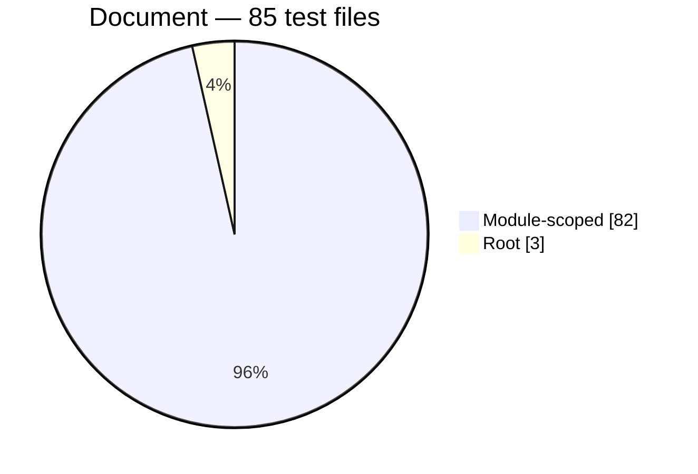

| Suite | Files | Share |
|---|---:|---:|
| Module-scoped | 82 | 96% |
| Root | 3 | 4% |

## Sources package

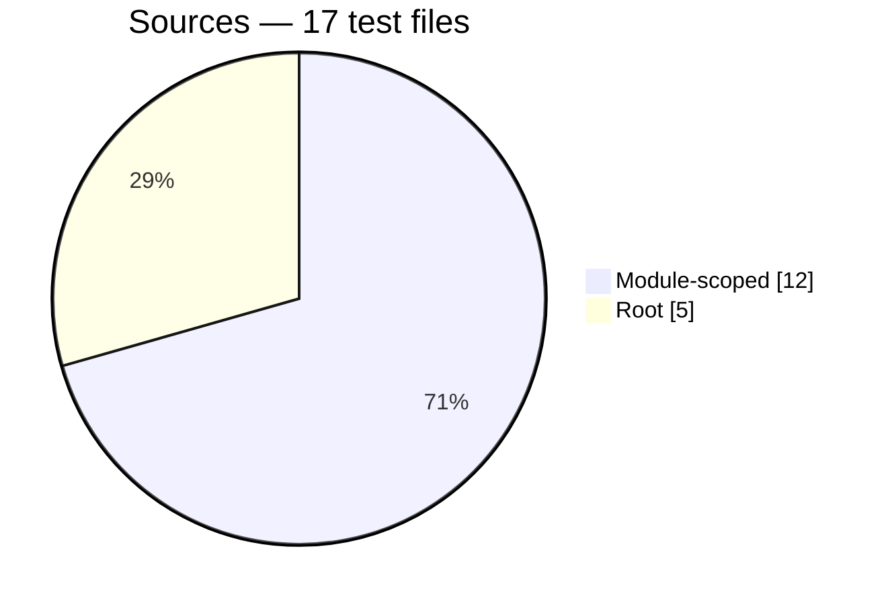

| Suite | Files | Share |
|---|---:|---:|
| Module-scoped | 12 | 71% |
| Root | 5 | 29% |

## Engine package

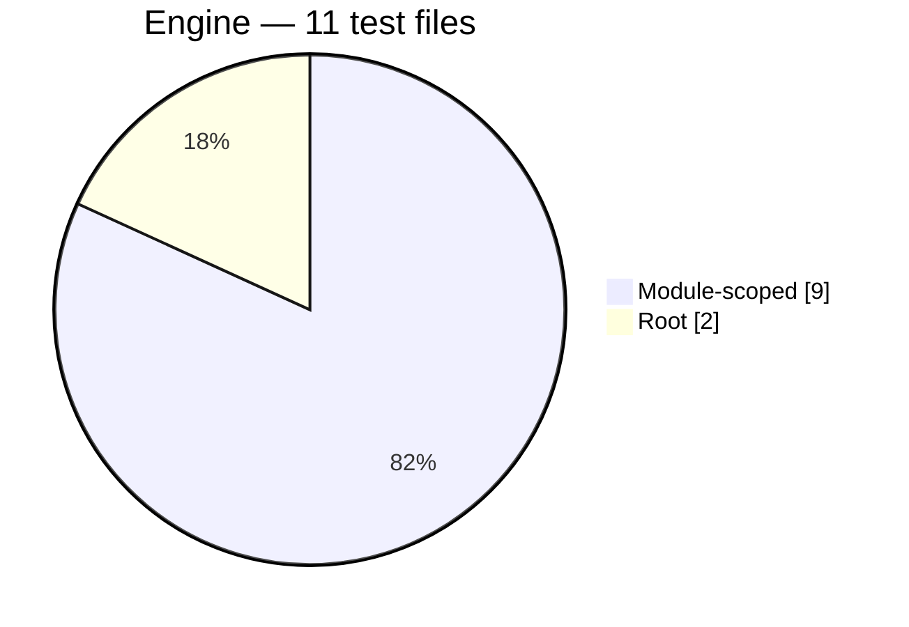

| Suite | Files | Share |
|---|---:|---:|
| Module-scoped | 9 | 82% |
| Root | 2 | 18% |

## Runner package

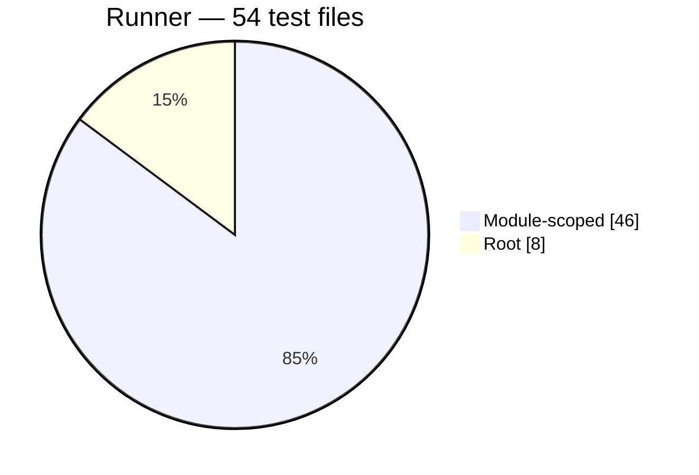

| Suite | Files | Share |
|---|---:|---:|
| Module-scoped | 46 | 85% |
| Root | 8 | 15% |

## Cli package

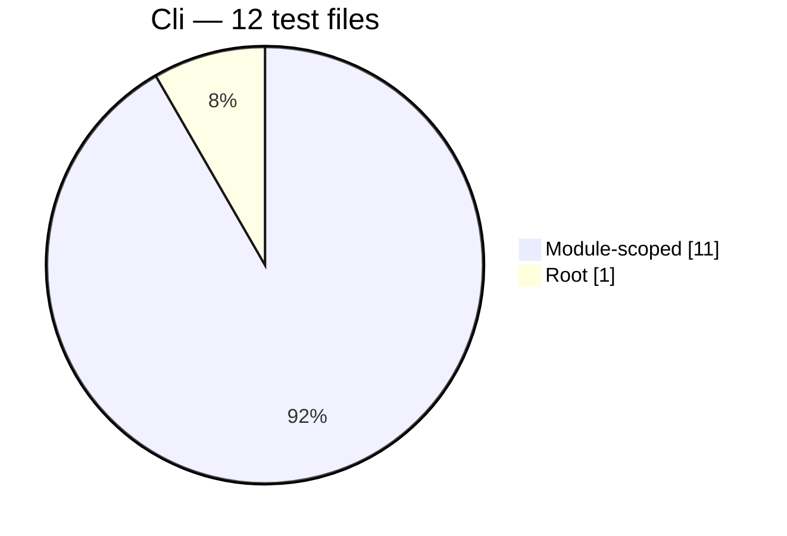

| Suite | Files | Share |
|---|---:|---:|
| Module-scoped | 11 | 92% |
| Root | 1 | 8% |

## Protocol-http package

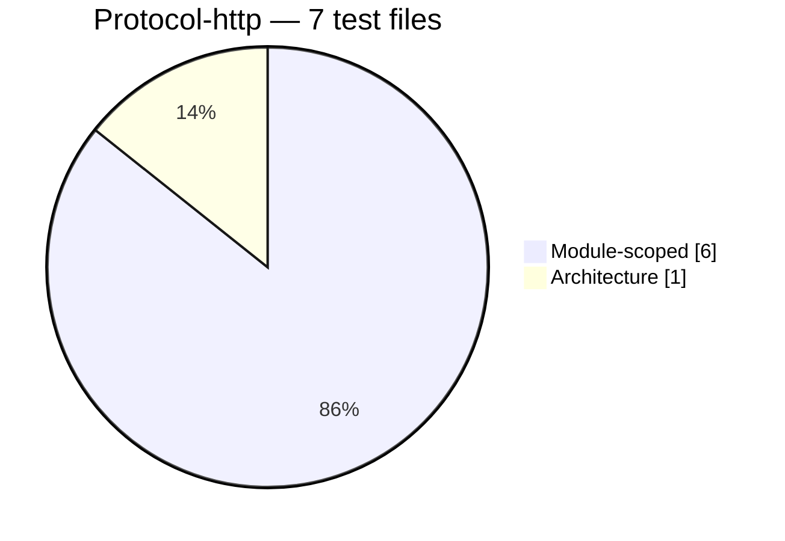

| Suite | Files | Share |
|---|---:|---:|
| Module-scoped | 6 | 86% |
| Architecture | 1 | 14% |

## Protocol-rpc package

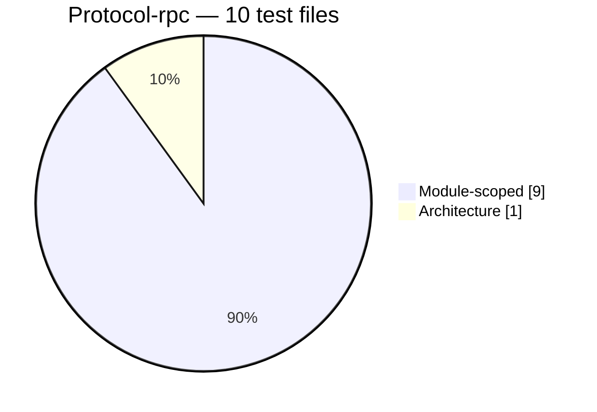

| Suite | Files | Share |
|---|---:|---:|
| Module-scoped | 9 | 90% |
| Architecture | 1 | 10% |

## Protocol-soap package

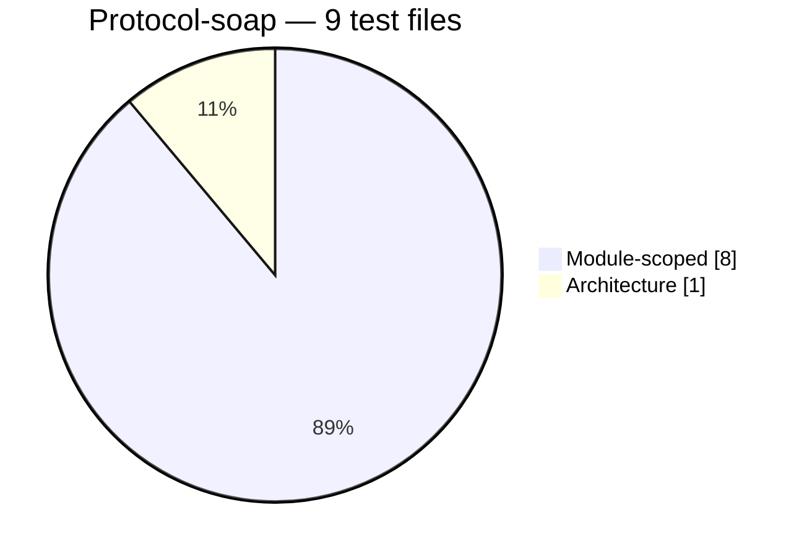

| Suite | Files | Share |
|---|---:|---:|
| Module-scoped | 8 | 89% |
| Architecture | 1 | 11% |

## Core package

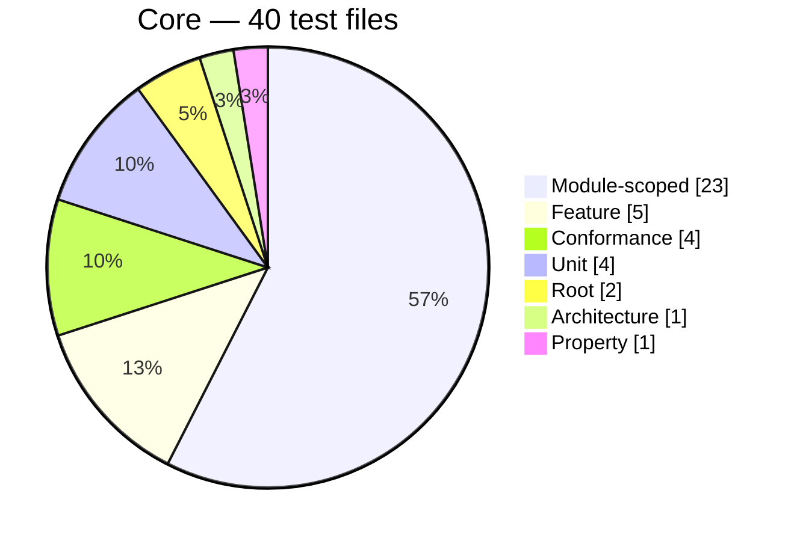

| Suite | Files | Share |
|---|---:|---:|
| Module-scoped | 23 | 57% |
| Feature | 5 | 12% |
| Conformance | 4 | 10% |
| Unit | 4 | 10% |
| Root | 2 | 5% |
| Architecture | 1 | 2% |
| Property | 1 | 2% |

## Core (integration) package

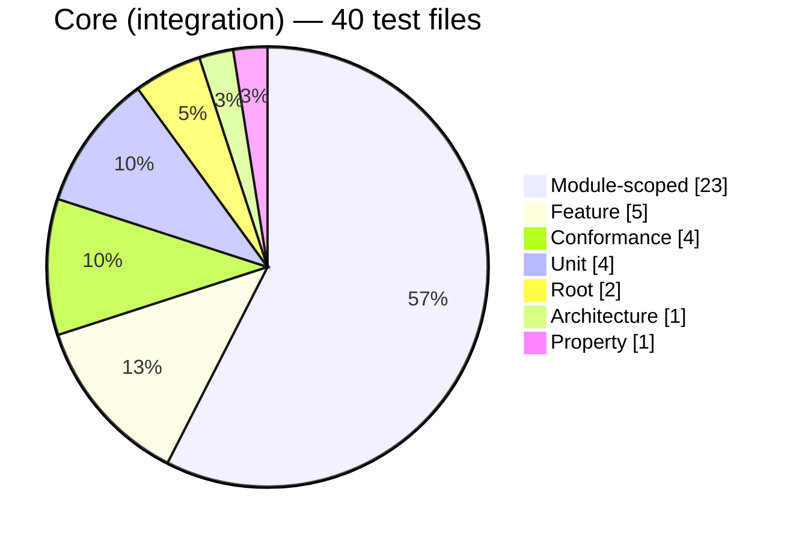

| Suite | Files | Share |
|---|---:|---:|
| Module-scoped | 23 | 57% |
| Feature | 5 | 12% |
| Conformance | 4 | 10% |
| Unit | 4 | 10% |
| Root | 2 | 5% |
| Architecture | 1 | 2% |
| Property | 1 | 2% |

## Laravel package

_No test files found._
