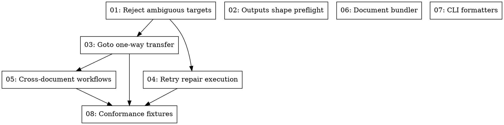

# Design Spec: Ecosystem Parity & Report Revalidation

- **Date**: 2026-10-14
- **Author**: Antigravity & Mohammed Alama
- **Status**: Approved
- **Topic**: Revalidation of `docs/php-arazzo-vs-arazzo-toolkit-report.md` and Phased Parity Backlog

## 1. Overview and Intent

This design documents the comprehensive revalidation of the cross-ecosystem comparison between `php-arazzo` and `arazzo-toolkit`. Since the initial report in August 2026, both repositories have undergone major architectural transformations:
- `php-arazzo` transitioned from a 2-package monolithic core to a 15-package decoupled monorepo, landing multi-protocol support (HTTP, SOAP/WSDL, RPC/Protobuf) and Arazzo 1.2 proposal grammar.
- `arazzo-toolkit` published `@usearazzo/parser`, `@usearazzo/resolver`, and `@usearazzo/validator` to npm (`v1.0.1-alpha.*`), introduced `@usearazzo/cli`, and implemented cross-document workflows, retry repair references, and goto workflow transfers in `@usearazzo/runner`.

This specification formalizes the updated capability baseline and establishes a tracer-bullet ticket backlog across three prioritized tiers to achieve full specification compliance and operational parity.

---

## 2. Updated Project Baselines

### 2.1 PHP Monorepo (`php-arazzo`)
- **Packages (15)**: `contracts`, `document`, `expression`, `evaluation`, `sources`, `runtime`, `runner`, `engine`, `events`, `cli`, `protocol-http`, `protocol-soap`, `protocol-rpc`, `core`, and `laravel`.
- **Supported Spec Versions**: Arazzo 1.0.0, 1.0.1, 1.1.0, and 1.2.0 proposal draft.
- **Protocols**: HTTP (OpenAPI 2.0/3.0/3.1), SOAP (WSDL), RPC (gRPC / Protobuf).
- **Execution Engine**: Canonical OMS state machine, event ledger, persistent state stores, distributed locks, queue workers, and Laravel integration.

### 2.2 TypeScript Monorepo (`arazzo-toolkit`)
- **Packages (5)**: `@usearazzo/parser`, `@usearazzo/resolver`, `@usearazzo/validator`, `@usearazzo/runner`, and `@usearazzo/cli`.
- **Release Status**: Parser, resolver, and validator published on npm (`v1.0.1-alpha.*`). Runner remains private in-monorepo.
- **Supported Spec Versions**: Arazzo 1.0.0, 1.0.1, 1.1.0 via `@speclynx/api-languageservice` JSON Schema.
- **Protocols**: Exclusively HTTP (OpenAPI 2.0/3.0/3.1).
- **Execution Engine**: In-memory asynchronous runner pipeline with cross-document locators and repair retry semantics.

---

## 3. Comparative Capability Matrix

| Capability | PHP Package (`php-arazzo`) | TypeScript Toolkit (`arazzo-toolkit`) | Current Parity Status |
|---|---|---|---|
| **Architecture** | 15 modular packages (ports & adapters) | 5 focused packages (ApiDOM-based) | High modularity across both |
| **Arazzo Spec Versions** | 1.0.0, 1.0.1, 1.1.0, 1.2.0 (proposal) | 1.0.0, 1.0.1, 1.1.0 | PHP ahead on 1.2 multi-protocol |
| **Package Distribution** | Composer dev monorepo | npm published (`parser`, `resolver`, `validator`) | Toolkit ahead on registry releases |
| **Protocols Supported** | HTTP, SOAP (WSDL), RPC (Protobuf) | HTTP (OpenAPI 2.0, 3.0, 3.1) | PHP broader protocol reach |
| **CLI Tooling** | `arazzo` CLI (`validate`, `run`, `list`, `render`) | `usearazzo` CLI (`validate`) | Parity on validate; PHP has run/render |
| **Validation Engine** | AST / Rule engine + schema rules | Language-service diagnostics (ApiDOM + JSON Schema) | Toolkit has LSP/formatting; PHP has rich rules |
| **Expression Evaluation** | Formal AST grammar + extensible plugins | Dedicated AST runtime-expression evaluator | High parity |
| **Cross-Document Workflows** | ⚠️ Incomplete (local workflows only) | ✅ Full support (`$sourceDescriptions.{name}.{workflowId}`) | **Toolkit Gap for PHP** |
| **Document Bundling & Resolving**| ⚠️ Relative source loading only | ✅ Dedicated `bundle()` & `resolve()` APIs | **Toolkit Gap for PHP** |
| **Retry Action References** | ⚠️ Jumps to target without repair return | ✅ Executes repair step/workflow, then retries | **Toolkit Gap for PHP** |
| **Goto Action Semantics** | ⚠️ Step jump only | ✅ Step jump + one-way workflow transfer | **Toolkit Gap for PHP** |
| **Output Shape Preflight** | ⚠️ Evaluated at completion | ✅ Preflight validated before prerequisites run | **Toolkit Gap for PHP** |
| **Execution State Machine** | Canonical OMS, event ledger, queue/sync engine | In-memory synchronous runner pipeline | PHP ahead on durable/queue execution |
| **Distributed Systems** | Locks, persistence, async worker, Laravel integration | In-memory only | PHP distinct advantage |

---

## 4. Technical Gap Specifications

### 4.1 Tier 1: Spec Compliance & Execution Semantics
1. **Ambiguous Target Rejection**:
   - Validation and runtime defense rejecting any action declaring both `stepId` and `workflowId` on `goto` or `retry`.
2. **Retry Repair References**:
   - When a failing step triggers a `retry` action specifying a `stepId` or `workflowId`, the runner executes that reference as an auxiliary repair operation.
   - Upon successful completion of the repair reference, context transfers back to re-attempt the failing step with the freshly computed outputs.
   - Repair steps consume the shared `stepBudget`.
3. **Step-Level Goto Workflow Transfer**:
   - `goto` targeting a `workflowId` is handled as a one-way transfer. The calling workflow terminates, and context transfers permanently to the target workflow.
4. **Workflow Outputs Preflight**:
   - Output expression syntax and variable references are validated before any prerequisite or step executes, preventing partial executions with unresolvable outputs.

### 4.2 Tier 2: Cross-Document & Bundling Capabilities
1. **Cross-Document Workflow Locators**:
   - Introduce `ArazzoWorkflowLocator` and locator normalizer to parse `$sourceDescriptions.{name}.{workflowId}`.
   - Support cross-document targets in `sub-workflow` steps, `dependsOn`, `retry.workflowId`, and `goto.workflowId`.
2. **Document Bundling API**:
   - Provide `ArazzoBundler::bundle()` to inline external `$ref` and schemas into a standalone document, with CLI command `arazzo bundle <file>`.

### 4.3 Tier 3: CLI & Tooling Parity
1. **CLI Formatters & Exit Codes**:
   - Add `--format=json` and `--format=stylish` to `arazzo validate`.
   - Return exit code 0 for valid documents, 1 for errors.
2. **Conformance Fixtures Sync**:
   - Vendor test fixtures from `arazzo-toolkit/packages/runner/test/fixtures/` and regenerate `docs/CONFORMANCE.md`.

---

## 5. Tracer-Bullet Tickets & Dependency Graph

The detailed ticket files are saved in `.scratch/ecosystem-parity/issues/`:
- `01-reject-ambiguous-goto-retry-targets.md`
- `02-preflight-validate-workflow-outputs-shape.md`
- `03-step-level-goto-workflow-transfer.md`
- `04-retry-action-repair-reference-execution.md`
- `05-cross-document-workflow-references.md`
- `06-document-bundler-api-and-cli.md`
- `07-cli-stylish-and-json-formatters.md`
- `08-vendor-conformance-fixtures.md`
