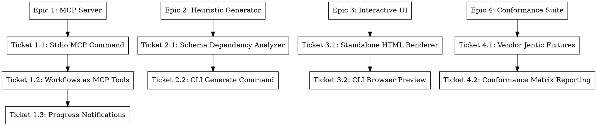

# Design Spec: Jentic Ecosystem Parity & AI Agent MCP Integration

- **Date**: 2026-10-14
- **Author**: Antigravity & Mohammed Alama
- **Status**: Approved
- **Topic**: Cross-ecosystem parity with `jentic-arazzo-tools` & `arazzo-engine`, covering MCP server, heuristic generation, and interactive visual UI.

## 1. Overview and Architecture

This design formalizes the implementation roadmap bridging feature gaps between `php-arazzo` and the Jentic ecosystem. While `php-arazzo` maintains a decisive lead in specification currency (Arazzo 1.0–1.2) and enterprise durable orchestration (queues, locks, persistence), Jentic has proven the value of developer-experience and agent-first workflows.

This specification outlines the technical design for four major capability tracks organized into an Epic hierarchy:
1. **Model Context Protocol (MCP) Server**: Exposing workflows as callable tools for AI coding assistants (Claude Desktop, Cursor, Windsurf, VS Code).
2. **Deterministic Heuristic Workflow Generator**: Synthesizing valid Arazzo workflows from OpenAPI schemas offline without LLMs.
3. **Interactive Visual Workflow Viewer & HTML Bundle**: Generating interactive, browser-executable visual workflow artifacts.
4. **Multi-Language Conformance Suite**: Validating execution parity against Jentic's reference workflows.

---

## 2. Technical Architecture by Track

### 2.1 Track 1: AI Agent Orchestration & Model Context Protocol (MCP)

#### Architecture
The Model Context Protocol (MCP) specification defines JSON-RPC communication between LLMs (clients) and local servers over standard input/output (stdio).

- **CLI Entrypoint**: `arazzo mcp <path-to-document>` starts a persistent Stdio JSON-RPC server loop in `packages/cli/src/Console/Command/McpCommand.php`.
- **Tool Discovery (`tools/list`)**:
  - Each workflow in the document is exposed as an MCP tool:
    - `name`: sanitized workflow ID (e.g. `order_pet_workflow`).
    - `description`: workflow description or generated summary.
    - `inputSchema`: synthesized JSON Schema derived from `workflow.inputs` and step parameters without fixed values.
- **Tool Execution (`tools/call`)**:
  - Validates provided arguments against `inputSchema`.
  - Dispatches execution to `RunnerFacade::execute()`.
  - Maps `ExecutionResult` outputs into standard MCP tool response text / structured JSON.
- **Progress Notifications (`notifications/progress`)**:
  - Implements an event subscriber on `packages/events` listening to `StepStartedEvent`, `StepExecutedEvent`, and `StepFailedEvent`.
  - Emits JSON-RPC progress notifications to the host client so the AI agent displays real-time execution steps.

### 2.2 Track 2: Deterministic OpenAPI Heuristic Workflow Generator

#### Architecture
Offline, rule-based synthesis in `packages/cli/src/Generator/HeuristicGenerator.php`:
- **Endpoint Classification**: Scans OpenAPI paths and operations, classifying them into CRUD roles (Create, Read, Update, Delete, List, Action) based on HTTP method, path segments, and response schemas.
- **Entity Dependency Graph**:
  - Identifies producer-consumer relationships: an operation producing an identifier (e.g., `POST /orders` returning `orderId` or `id`) is matched to operations consuming that identifier in path/query parameters (e.g., `GET /orders/{orderId}`).
- **Sequence Synthesis**:
  - Emits an `ArazzoDocument` with logical sequences: `create -> verify/get -> update -> delete`.
  - Binds parameter expressions automatically: `value: {$steps.create_step.outputs.id}`.
- **CLI Command**: `arazzo generate <openapi.json> --heuristic --output=workflow.arazzo.yaml`.

### 2.3 Track 3: Interactive Visual Workflow Viewer & HTML Bundle

#### Architecture
- **HTML Bundle Generator (`packages/cli/src/Renderer/HtmlRenderer.php`)**:
  - Self-contained single-file HTML document requiring zero build steps or external network requests.
  - Inlines bundled SVG/CSS rendering an interactive flowchart with nodes for steps, dashed lines for retry/goto transitions, and status badges.
  - Split view panel displaying markdown documentation, operation parameters, and expected outputs.
- **CLI Preview (`arazzo view <file>`)**:
  - Spins up a local ephemeral PHP built-in web server (`php -S localhost:<port>`).
  - Launches the default system browser (`open http://localhost:<port>`).

### 2.4 Track 4: Multi-Language Cross-Conformance Suite

#### Architecture
- Vendor test fixtures from `jentic/jentic-arazzo-tools` and `jentic/arazzo-engine` into `packages/core/tests/fixtures/jentic/`.
- Verify in Pest that `php-arazzo` parser, validator, and runner process these fixtures cleanly and produce equivalent execution verdicts.

---

## 3. Epic & Ticket Hierarchy

The 4 Epics and 9 Child tickets will be tracked locally in `.scratch/jentic-parity/issues/` and published to GitHub via `gh cli`.
